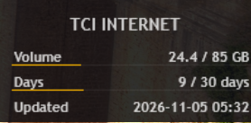

# گجت رینمتر اینترنت مخابرات (TCI)

**[Read this in English](README.md)**

یک پایپ‌لاین پایتون کاملاً خودکار که وارد **پنل مخابرات** (`internet.tci.ir/panel/`) می‌شود، کپچای صوتی را حل می‌کند و حجم و روزهای باقی‌مانده شما را به یک گجت سبک و سفارشی رینمتر روی دسکتاپ منتقل می‌کند.

## 📸 پیش‌نمایش
 

## ✨ ویژگی‌ها
* **کاملاً خودکار:** به صورت بی‌صدا در پس‌زمینه توسط Windows Task Scheduler اجرا می‌شود.
* **دور زدن کپچا:** از یک یوزراسکریپت محلی برای حل خودکار کپچای صوتی TCI استفاده می‌کند.
* **پشتیبانی از پروکسی:** کاملاً سازگار با پروکسی‌های محلی (مثلاً `127.0.0.1:12334`) برای دسترسی از خارج از کشور.
* **سبک:** پایتون داده‌ها را استخراج کرده و در یک فایل متنی ساده می‌نویسد. رینمتر فایل متنی را می‌خواند و تقریباً هیچ پردازشی مصرف نمی‌کند.

## 🛠️ پیش‌نیازها
1. نصب بودن **پایتون نسخه 3.13** یا بالاتر.
2. نصب بودن **گوگل کروم**.
3. نصب بودن **رینمتر (Rainmeter)**.

## 🚀 راه‌اندازی و نصب

### ۱. وابستگی‌های پایتون
ترمینال را در پوشه پروژه باز کنید و وابستگی‌ها را نصب کنید:
    pip install -r requirements.txt

### ۲. دانلودهای دستی (الزامی)
شما باید این دو فایل را به صورت دستی دانلود کرده و در پوشه اصلی پروژه قرار دهید:

* **درایور کروم (ChromeDriver):** فایل ZIP را برای نسخه کروم خود دانلود کنید، `chromedriver.exe` را استخراج کرده و در پوشه قرار دهید.
  [دانلود ChromeDriver](https://storage.googleapis.com/chrome-for-testing-public/156.0.8078.80/win64/chromedriver-win64.zip)
* **یوزراسکریپت حل کپچا:** یوزراسکریپت را دانلود کرده و با نام `tci-captcha-solver.user.js` در پوشه ذخیره کنید.
  [دانلود TCI Captcha Auto-Solver](https://greasyfork.org/scripts/595780-tci-captcha-auto-solver)

### ۳. تنظیمات
فایل `tci_fetcher.py` را باز کرده و بلوک تنظیمات بالای آن را با اطلاعات خود ویرایش کنید:
    USERNAME       = "YOUR_TCI_USERNAME"
    PASSWORD       = "YOUR_TCI_PASSWORD"
    PROXY          = "http://127.0.0.1:12334"
    CHROME_VERSION = 156

### ۴. نصب گجت رینمتر
1. پوشه Skins رینمتر را باز کنید (روی آیکون قطره رینمتر در نوار وظیفه راست‌کلیک کنید -> **Manage** -> **Open folder**).
2. پوشه `Rainmeter` را از این مخزن به پوشه Skins خود کپی کنید. **نام پوشه را به `TCI_Usage` تغییر دهید**.
3. اسکریپت پایتون را یک بار به صورت دستی اجرا کنید تا فایل `tci_data.txt` ایجاد شود: `python tci_fetcher.py`.
4. روی آیکون قطره رینمتر راست‌کلیک کرده و **Refresh all** را بزنید.
5. در پنجره Manage، پوشه `TCI_Usage` را باز کرده و روی `TCI_Usage.ini` دابل کلیک کنید تا گجت روی دسکتاپ بارگذاری شود.
6. گجت را به محل دلخواه خود بکشید.

## ⏰ خودکارسازی (زمان‌بند وظایف)
برای اینکه اسکریپت هر ۳۰ دقیقه به صورت خودکار اجرا شود، Command Prompt را به عنوان Administrator باز کرده و دستور زیر را اجرا کنید:
    schtasks /Create /TN "TCI Data Fetcher" /TR "\"C:\Path\To\pythonw.exe\" \"C:\Path\To\tci_fetcher.py\"" /SC MINUTE /MO 30 /RL HIGHEST /F
*(مطمئن شوید که `C:\Path\To\` را با مسیر واقعی فایل‌های خود جایگزین کرده‌اید).*

## 🔧 عیب‌یابی
* **خطای `ModuleNotFoundError: No module named 'distutils'`**: پایتون 3.12+ ماژول `distutils` را حذف کرده است. با اجرای `pip install setuptools` آن را برطرف کنید.
* **خطای `urllib.error.HTTPError: HTTP Error 403: Forbidden`**: دانلود خودکار مسدود شده است. `chromedriver.exe` را به صورت دستی دانلود کرده و در پوشه قرار دهید.
* **نمایش `0 / 0 GB`**: اسکریپت قبل از بارگذاری اعداد توسط جاوااسکریپت TCI، HTML را دریافت کرده است. فایل `tci_fetcher.py` را باز کنید، مقدار `time.sleep(4)` را درست قبل از `parse_stats` پیدا کرده و آن را به `time.sleep(6)` افزایش دهید.
* **خطای `None of these selectors matched`**: TCI صفحه ورود خود را تغییر داده است. اسکریپت را با `HEADLESS = False` اجرا کنید، مرورگر را تماشا کرده و سلکتورهای CSS را در بخش `find_first()` اسکریپت پایتون به‌روزرسانی کنید.
* **خطای `Error:All 3 attempts failed`**: پروکسی خود را بررسی کنید. مطمئن شوید که پروکسی محلی شما در حال اجرا بوده و به درستی به ایران مسیریابی می‌شود.
