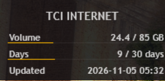

# TCI Internet Rainmeter Gadget

**[Read this in Persian (فارسی)](README.fa.md)**

A fully automated Python pipeline that logs into the **TCI panel** (`internet.tci.ir/panel/`), solves the audio CAPTCHA, and feeds your remaining data and days into a lightweight, custom Rainmeter desktop gadget.

## 📸 Preview 
 


## ✨ Features
* **Fully Automated:** Runs silently in the background via Windows Task Scheduler.
* **CAPTCHA Bypass:** Utilizes a local userscript to automatically solve TCI's audio CAPTCHA.
* **Proxy Support:** Fully compatible with local proxies (e.g., `127.0.0.1:12334`) for geo-blocked access.
* **Lightweight:** Python scrapes the data and writes it to a simple text file. Rainmeter reads the text file, requiring almost zero CPU/RAM.

## 🛠️ Prerequisites
1. **Python 3.13+** installed.
2. **Google Chrome** installed.
3. **Rainmeter** installed.

## 🚀 Setup & Installation

### 1. Python Dependencies
Open a terminal in the project folder and install the dependencies:
```bash
pip install -r requirements.txt
```

### 2. Manual Downloads (Required)
You must manually download these two files and place them in the root folder of this project:

* **ChromeDriver:** Download the ZIP file for your Chrome version, extract `chromedriver.exe`, and place it in the folder.
  [Download ChromeDriver](https://storage.googleapis.com/chrome-for-testing-public/156.0.8078.80/win64/chromedriver-win64.zip)
* **CAPTCHA Solver Userscript:** Download the userscript and save it as `tci-captcha-solver.user.js` in the folder.
  [Download TCI Captcha Auto-Solver](https://greasyfork.org/scripts/595780-tci-captcha-auto-solver)

### 3. Configuration
Open `tci_fetcher.py` and edit the top configuration block with your credentials:
    USERNAME       = "YOUR_TCI_USERNAME"
    PASSWORD       = "YOUR_TCI_PASSWORD"
    PROXY          = "http://127.0.0.1:12334"
    CHROME_VERSION = 156

### 4. Rainmeter Gadget Installation
1. Open your Rainmeter Skins folder (Right-click the Rainmeter droplet icon in your taskbar -> **Manage** -> **Open folder**).
2. Copy the `Rainmeter` folder from this repository into your Skins directory. **Rename the folder to `TCI_Usage`**.
3. Run the Python script once manually to generate the `tci_data.txt` file: `python tci_fetcher.py`.
4. Right-click the Rainmeter droplet icon and click **Refresh all**.
5. In the Manage window, expand `TCI_Usage` and double-click `TCI_Usage.ini` to load the gadget onto your desktop.
6. Drag the gadget to your preferred spot.

## ⏰ Automation (Task Scheduler)
To make it run automatically every 30 minutes, open Command Prompt as Administrator and run:
    schtasks /Create /TN "TCI Data Fetcher" /TR "\"C:\Path\To\pythonw.exe\" \"C:\Path\To\tci_fetcher.py\"" /SC MINUTE /MO 30 /RL HIGHEST /F
*(Make sure to replace `C:\Path\To\` with your actual file paths).*

## 🔧 Troubleshooting
* **`ModuleNotFoundError: No module named 'distutils'`**: Python 3.12+ removed `distutils`. Fix it by running `pip install setuptools`.
* **`urllib.error.HTTPError: HTTP Error 403: Forbidden`**: The auto-downloader is blocked. Manually download `chromedriver.exe` and put it in the folder.
* **Data shows `0 / 0 GB`**: The script grabbed the HTML before TCI's JavaScript loaded the numbers. Open `tci_fetcher.py`, find `time.sleep(4)` right before `parse_stats`, and increase it to `time.sleep(6)`.
* **`None of these selectors matched`**: TCI changed their login page. Run the script with `HEADLESS = False`, watch the browser, and update the CSS selectors in the `find_first()` section of the Python script.
* **`Error:All 3 attempts failed`**: Check your proxy. Ensure your local proxy is running and routing to Iran properly.
